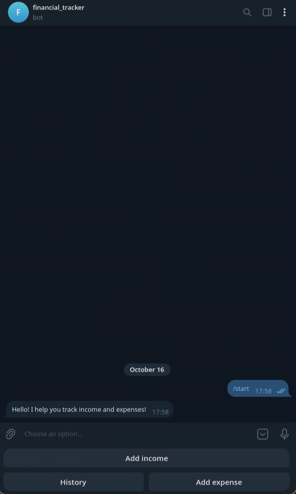
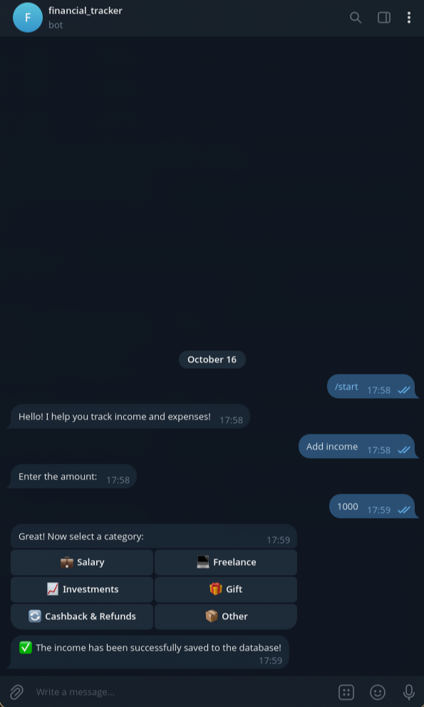
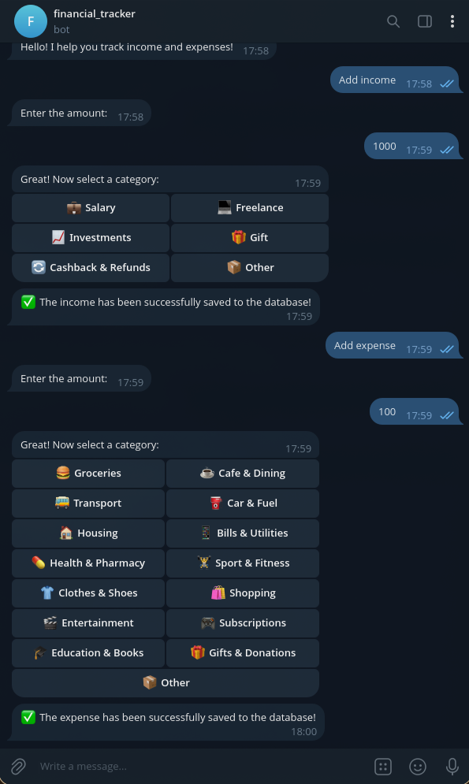
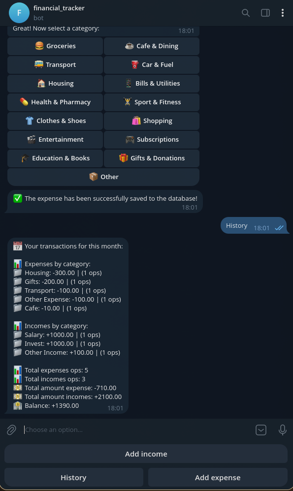
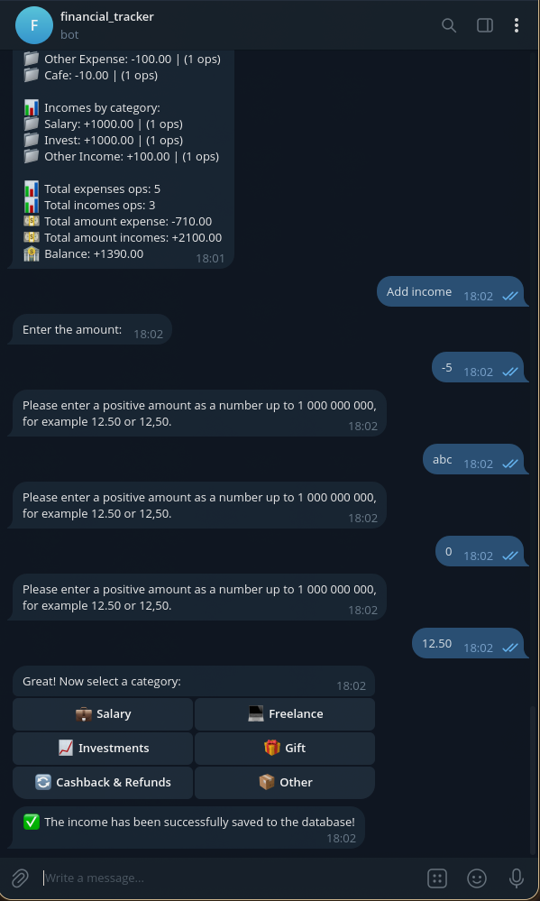

# Financial Tracker Bot

A Telegram bot for tracking personal income and expenses, built with **aiogram 3.x**. Users record transactions through simple step-by-step dialogs — enter an amount, pick a category — and can request a monthly report with a breakdown by category, totals, and balance. All data is stored per-user in a local SQLite database.

## Screenshots

| | |
|---|---|
| <br>*`/start` and the main menu* | <br>*Adding income — choosing one of 6 categories* |
| <br>*Adding an expense — choosing one of 15 categories* | <br>*Monthly history with totals and balance* |
| <br>*Amount validation with a format hint* | |

## Features

- **Commands**
  - `/start` — greets the user, shows the main menu, and resets any active dialog.
  - `/cancel` — cancels the current scenario at any point and returns to the main menu.
- **Main menu** (reply keyboard): `Add income`, `Add expense`, `History`.
- **Dialog-based operation adding** (FSM): the bot first asks for an amount, then shows an inline keyboard with categories, then saves the operation.
- **Categories**
  - 15 expense categories: 🍔 Groceries, ☕ Cafe & Dining, 🚌 Transport, ⛽ Car & Fuel, 🏠 Housing, 📱 Bills & Utilities, 💊 Health & Pharmacy, 🏋️ Sport & Fitness, 👕 Clothes & Shoes, 🛍️ Shopping, 🎬 Entertainment, 🎮 Subscriptions, 🎓 Education & Books, 🎁 Gifts & Donations, 📦 Other.
  - 6 income categories: 💼 Salary, 💻 Freelance, 📈 Investments, 🎁 Gift, 🔄 Cashback & Refunds, 📦 Other.
- **Amount validation** — accepts `12.50` or `12,50` (dot or comma as the decimal separator), must be greater than 0 and no more than 1 000 000 000, rounded to 2 decimal places. Invalid input gets a hint with the expected format instead of an error.
- **Monthly history** — grouped by category (sorted by amount), with the number of operations per category, total expense/income amounts and operation counts, and the resulting balance.
- **Per-user data** — every record is tied to the user's Telegram ID, so multiple users can share one bot without seeing each other's data.
- **Outdated button handling** — pressing an inline button from an old/finished dialog shows an "Outdated button" notification instead of failing.
- **Global error handler** — any unhandled exception is logged, and the user gets a friendly "Something went wrong, try again" message instead of silence.

## Tech Stack

- [aiogram](https://docs.aiogram.dev/) 3.31.0 — async Telegram Bot API framework
- [python-dotenv](https://pypi.org/project/python-dotenv/) 1.2.3 — loading configuration from `.env`
- SQLite (built-in `sqlite3` module) — persistent storage
- Long **polling** mode (`Dispatcher.start_polling`) — no webhook/public host required
- FSM with the default in-memory storage

## Getting Started

### 1. Create a bot and get a token

1. Open [@BotFather](https://t.me/BotFather) in Telegram.
2. Send `/newbot` and follow the prompts.
3. Copy the token it gives you (it looks like `123456789:AA...`).

### 2. Clone and install

```bash
git clone https://github.com/verycik56340-alt/financial-tracker-bot.git
cd financial-tracker-bot

python -m venv .venv
source .venv/bin/activate        # Linux/macOS
# .venv\Scripts\activate         # Windows

pip install -r requirements.txt
```

### 3. Configure

```bash
cp .env.example .env
```

Open `.env` and paste your token:

```
BOT_TOKEN=123456789:AA...
```

### 4. Run

```bash
python main.py
```

The database is created and migrated automatically on first start. Open the bot in Telegram and send `/start`.

## Configuration

| Variable  | Required | Description                                                                                     |
|-----------|----------|-------------------------------------------------------------------------------------------------|
| `BOT_TOKEN` | Yes      | Token from [@BotFather](https://t.me/BotFather). The bot exits with an error message if it is missing. |
| `DB_PATH`   | No       | Path to the SQLite database file. If unset, `finance.db` is created next to `database.py`.       |

## Project Structure

```
financial-tracker-bot/
├── main.py            # Entry point: env loading, Dispatcher setup, global error handler, polling
├── handlers.py        # Commands, FSM dialog scenarios, amount validation, monthly report
├── keyboards.py       # Main menu (reply keyboard) and category keyboards (inline)
├── database.py        # SQLite layer: init/migration, insert operations, monthly queries
├── requirements.txt
├── .env.example       # Environment variable template
└── docs/
    └── screenshots/   # Bot screenshots for this README
```

## Known Limitations

- **FSM states are stored in memory** — if the bot restarts mid-dialog, the user's progress is lost and they have to start the scenario again.
- **Synchronous `sqlite3` calls inside async handlers** — database operations block the event loop, which is fine for light personal use but not ideal under heavy load.
- **No editing or deleting of operations** — once saved, a record cannot be changed or removed via the bot.
- **History covers the current month only** — there is no way to view previous months.
- **Timestamps come from the server clock** (`datetime.now()`), so all dates reflect the server's local time, not the user's timezone.
- **Single currency without a symbol** — amounts are plain numbers; there is no currency selection or display (e.g. `$`, `€`).
- **Dates are stored as `TEXT` and matched with `LIKE 'YYYY-MM%'`** — simple but not index-friendly and relies on a fixed date format.
- **Amounts are stored as `REAL`** (floating point), which can introduce minor rounding artifacts for money values.
- **No automated tests**.
